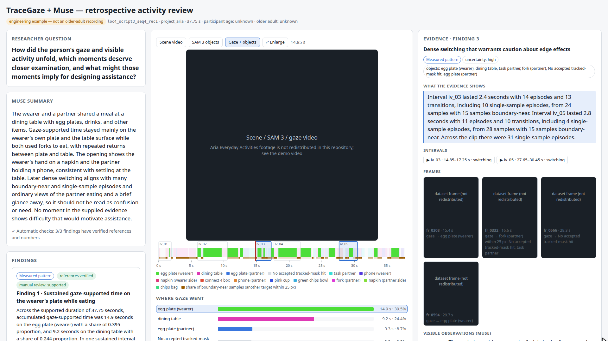
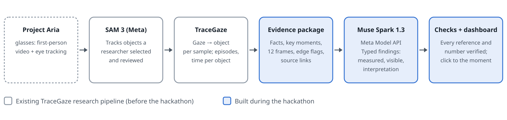

# TraceGaze + Muse

**An understanding layer for AI that supports older adults in everyday life,
including the moments when recognising or explaining what help is needed is hard.**

TraceGaze turns first-person video and eye tracking into object-grounded,
time-stamped evidence: which object each gaze sample landed on, how gaze moved
between objects, and how long it stayed. **Muse Spark** reads that evidence
together with a few key frames and returns findings about the activity and
candidate opportunities for support. Every finding links back to the video
interval, frames and measurements behind it, and every number it quotes is
checked automatically.

The current prototype performs **retrospective** analysis for researchers
studying everyday activities and people designing assistance. Proactive,
real-time assistance is the future this understanding layer is meant to enable.
It is not part of this prototype.

> **Demo video:** _link to be added_ (3 min)


<sub>Dataset footage is masked in these screenshots because the Aria Everyday
Activities licence does not allow redistribution; the demo video shows the full dashboard.</sub>

## What it does

1. **What the wearer experienced.** First-person video plus eye tracking from
   Project Aria glasses.
2. **Gaze becomes object context.** SAM 3 tracks the objects a researcher selected
   and reviewed. TraceGaze assigns every gaze sample to the object mask it
   lands on, without guessing when no mask is hit.
3. **Temporal patterns become visible.** Gaze episodes, transitions, revisits and
   time per object are computed deterministically. A sample is flagged as
   boundary-near when another object lies within 25 px, so rapid switching at
   object edges is not mistaken for behaviour.
4. **Muse interprets the evidence.** A researcher asks a question. Muse Spark 1.3
   receives a bounded evidence package (facts, rule-selected candidate moments,
   12 frames) and answers with about three findings. Each finding is typed as a
   *measured pattern*, *visible observation* or *possible interpretation* and
   carries alternatives, limitations and a support-opportunity verdict.
5. **Inspect the moment behind an insight.** In the dashboard, clicking a finding
   opens its interval in the video and shows the frames Muse saw and every
   cited measurement. Each one is compared with the value TraceGaze computed.

## Meta models and their roles

| Model | Role | How it is used |
|---|---|---|
| **Muse Spark 1.3** (`muse-spark-1.3`, Meta Model API) | Interpretation | One `POST /v1/chat/completions` request with a JSON-schema response, the evidence package and 12 JPEG frames. It never computes numbers; it copies them from supplied facts. |
| **SAM 3** (`facebook/sam3`) | Perception | Segments and tracks the researcher-selected objects through the video (existing TraceGaze stage). |
| Project Aria glasses / MPS eye gaze | Sensing | Source of first-person video and gaze. The example uses the Aria Everyday Activities dataset. |

## Architecture



```
Aria video + gaze ─► SAM 3 object tracking ─► gaze↔object fusion ─► attention trace
     (foundation)          (foundation)            (foundation)        (foundation)
                                                                            │
          dashboard ◄─ checks ◄─ Muse Spark 1.3 ◄─ evidence package ◄───────┘
         (hackathon)  (hackathon)   (hackathon)       (hackathon)
```

## Existing foundation vs. hackathon work

The git history makes the split explicit: the first commit imports the existing
TraceGaze research pipeline unchanged except for anonymised paths and participant
identifiers in tests and docs; everything
after it was built during the hackathon.

| Existing TraceGaze foundation (before the hackathon) | Built during the hackathon |
|---|---|
| `pipeline/aria_source`: Aria VRS/MPS preparation and trimming | `tracegaze_analyst/support_package.py`: evidence package, rule-selected candidate moments, boundary proximity, frames |
| `pipeline/object_tracking`: SAM 3 tracking GUI and worker | `tracegaze_analyst/muse.py`: Meta Model API client (stdlib only) |
| `pipeline/gaze_object_fusion`: per-sample gaze↔mask fusion | `tracegaze_analyst/findings.py`: findings schema, prompt, validator, independent re-derivation of every fact |
| `pipeline/attention_trace`: episodes, transitions, revisits | `tracegaze_analyst/support_report.py`: dashboard (demo mode, three video views, gaze bars, evidence panel) |
| `pipeline/workbench`, `neon_trim`, `common`: launcher and shared code | `tracegaze_analyst/support_cli.py`, tests, `demo/` recording and editing tools |
| `tracegaze_analyst` v1: fact catalogue and local-model analyst | `examples/aea_meal_v1_run/`: the real Muse run record |

## Setup

Tested on Ubuntu 24.04 with Python 3.12. GPUs are needed only for SAM 3 tracking
(we used NVIDIA RTX PRO 6000 / 5000 Blackwell); the Muse layer and dashboard run on CPU.

```bash
git clone <this repository> && cd tracegaze-muse

# 1) pipeline, GUIs, analyst and dashboard (the code expects this venv name)
uv venv ~/.venvs/neon-trim --python 3.12
VIRTUAL_ENV=~/.venvs/neon-trim uv pip install -r requirements.txt

# 2) Muse credentials: copy and fill in, never commit
cp .env.example .env            # set MODEL_API_KEY from https://dev.meta.ai

# 3) only to rerun SAM 3 tracking: torch + SAM 3 in their own venv
uv venv ~/.venvs/sam3 --python 3.12
VIRTUAL_ENV=~/.venvs/sam3 uv pip install torch --index-url https://download.pytorch.org/whl/cu128
git clone https://github.com/facebookresearch/sam3 && (cd sam3 && git apply ../patches/sam3_point_prompt.patch)  # see patches/README.md
VIRTUAL_ENV=~/.venvs/sam3 uv pip install -e ./sam3   # weights: request access to facebook/sam3 on Hugging Face

# 4) only to prepare Aria recordings from VRS
uv venv ~/.venvs/aria --python 3.12
VIRTUAL_ENV=~/.venvs/aria uv pip install projectaria-tools
```

## Example data

The demo uses **Aria Everyday Activities (AEA) 1.0.0**, recording
`loc4_script3_seq4_rec1`, source frames 709–1463 (37.75 s of a shared breakfast).
The AEA licence does not allow redistribution of the dataset or derived works,
so no footage, frames or derived measurement packages are included here. To reproduce:

1. Request access at <https://www.projectaria.com/datasets/aea/> and download
   `loc4_script3_seq4_rec1` (main VRS recording + MPS eye gaze) into `data/`
   (gitignored), e.g. `data/aria/AriaEverydayActivities_loc4_script3_seq4_rec1/`.
2. `~/.venvs/neon-trim/bin/python pipeline/workbench/server.py` → <http://127.0.0.1:8000>.
   The workbench starts its stage servers from `.claude/launch.json` (paths assume the venv names above).
   Use the guided flow **Choose Aria folder → Prepare → Trim (709–1463) → Track (SAM 3) → Fuse**.
   Tracking is interactive: select, name and review each object.
3. Run the rest from `pipeline/`:

```bash
cd pipeline
PY=~/.venvs/neon-trim/bin/python
E=../out/aea_meal_v1
$PY -m attention_trace --fusion <..._gaze_fusion dir> --out $E/attention_trace
$PY -m tracegaze_analyst support-package --trace $E/attention_trace \
    --config tracegaze_analyst/examples/aea_loc4_script3_seq4_rec1.json --out $E/package
$PY -m tracegaze_analyst muse-findings --package $E/package --out $E/muse_run \
    --reasoning-effort high --max-completion-tokens 32000 --env-file ../.env
$PY -m tracegaze_analyst check-findings --package $E/package --run $E/muse_run
$PY -m tracegaze_analyst tamper-check  --package $E/package --run $E/muse_run
$PY -m tracegaze_analyst support-report --example $E
$PY -m tracegaze_analyst serve-report  --example $E --port 8765
# open http://127.0.0.1:8765/report/index.html?demo=1
```

`examples/aea_meal_v1_run/` holds the record of the real Muse request shown in
the demo: the findings, validation, tamper test, manual review and request
metadata (model, response id, token usage, input hashes). It contains no
credentials and no dataset imagery.

## What the checks guarantee, and what they do not

- **Checked automatically:** every cited interval, frame, episode, object and fact
  exists; every number Muse copies equals the deterministic value; numbers in
  prose trace to cited evidence; evidence text contains no construct words
  (confusion, memory, difficulty …) or personal-attribute words; each
  interpretation carries an alternative explanation and medium/high uncertainty.
  Separately, every package fact is recomputed from the TraceGaze files. A tamper
  test showed that six kinds of corruption are each caught.
- **Not guaranteed:** that an interpretation is correct. That is what the manual
  review records. In the demo run, 1 finding was judged supported and 2
  partially supported.

## Honest scope

- One recording and one Muse run. The participant's age is unknown, so this is an
  engineering example, not an older-adult study.
- No accuracy, time-saving or benefit claims are made.
- Hands are not tracked, so gaze on the wearer's own hand counts as "no accepted
  tracked-mask hit".
- The 25 px boundary-proximity threshold is a project convention, not a measured
  gaze-accuracy bound.

## Repository layout

```
pipeline/            TraceGaze stages (+ tracegaze_analyst: Muse layer and dashboard)
patches/             one local patch to SAM 3 (point prompts), with provenance notes
demo/                headless-Chrome walkthrough recorder, clip editor, narration
docs/                architecture diagram, screenshots, hackathon record
examples/            the real Muse run record for the demo recording
```

Tests: `~/.venvs/neon-trim/bin/python -m pytest pipeline -q` (315 pass; 17 skip
without private or downloaded recordings, or a GPU).

## Data and licences

- Demo data: *Aria Everyday Activities Dataset, Meta Reality Labs-R*, used under its
  licence. Not redistributed here.
- SAM 3 is used under its own licence and is not vendored; `patches/` contains only
  a small diff.
- Code: MIT (see `LICENSE`). SAM 3 and the AEA data keep their own licences.
